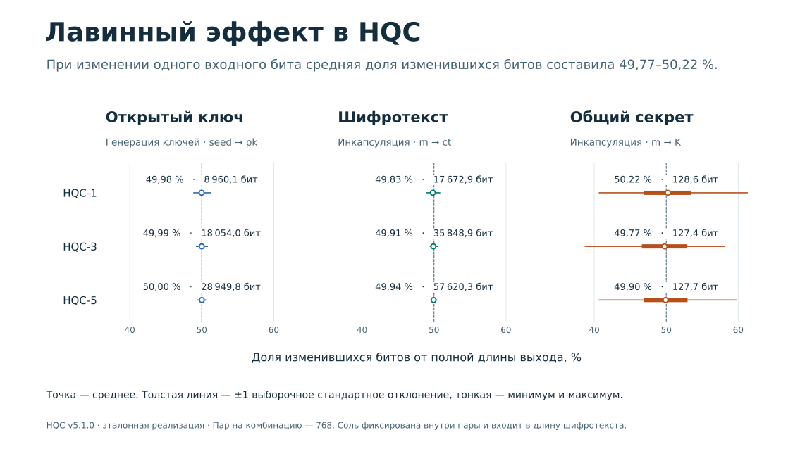

# Лавинный эффект HQC-1, HQC-3 и HQC-5

Как меняются открытый ключ, шифротекст и общий секрет HQC, если инвертировать ровно один
входной бит? Для каждого набора параметров измерены 768 пар при генерации ключей и
768 пар при инкапсуляции. Опыт проведён на переносимой эталонной реализации команды HQC
`v5.1.0`. Эти результаты можно использовать для сверки, когда в pqlab появится собственный
HQC. [Версия спецификации, кода и официальных векторов](../src/kem/hqc/README.md)

## Результаты



Расстояние Хэмминга — число позиций, в которых два выхода пары различаются. В таблице за
100 % принята полная длина соответствующего выхода в битах. Для общего секрета это 256 бит
на всех трёх уровнях. Для шифротекста в длину входят и 16 байт соли, одинаковые в паре.

| Набор | Seed → открытый ключ, бит (%) | Сообщение → шифротекст, бит (%) | Сообщение → общий секрет, бит (%) |
|---|---:|---:|---:|
| HQC-1 | 8 960,08 (49,98 %) | 17 672,89 (49,83 %) | 128,56 (50,22 %) |
| HQC-3 | 18 053,95 (49,99 %) | 35 848,92 (49,91 %) | 127,42 (49,77 %) |
| HQC-5 | 28 949,75 (50,00 %) | 57 620,30 (49,94 %) | 127,75 (49,90 %) |

Во всех трёх наборах однобитное изменение затронуло в среднем около половины открытого
ключа или шифротекста. В общем секрете менялось в среднем от 127 до 129 из 256 бит
при округлении до целого. Число изменённых битов в отдельных парах видно на графике.

## Как поставлен опыт

| Что меняли | Что сравнивали | Что оставалось одинаковым внутри пары |
|---|---|---|
| Один бит 32-байтового `seed_kem` в KeyGen | Два сериализованных открытых ключа `pk` | Набор параметров. Вся случайность KeyGen задаётся этим seed. |
| Один бит внутреннего сообщения `m` в Encaps | Два полных шифротекста `ct` и отдельно два общих секрета `K` | Один и тот же открытый ключ и одна и та же 16-байтовая соль. |

Для каждой пары исходные `seed_kem`, `m` и соль заново выводятся из SHAKE256 по публичной
метке с именем набора и номером пары. Биты перебираются по кругу, с младшего бита байта.
Все 256 позиций seed проверены по три раза. Длина `m` равна 128, 192 и 256 битам, поэтому
каждая его позиция проверена соответственно шесть, четыре и три раза. Обе метрики Encaps
получены из одной и той же пары вызовов. [Адаптер измерений](../tests/diff/hqc_avalanche/adapter.cpp)

Перед измерением по всем 100 официальным векторам каждого уровня сверяются открытый и
закрытый ключи, шифротекст, общий секрет и результат декапсуляции. На первой паре каждого уровня
проверяется точное совпадение выходов при повторе неизменённых входов. В каждой измеренной
паре проверяются расстояние входов в один бит, совпадение соли и восстановление обоих общих
секретов через Decaps. В CSV записаны номера изменённых битов и расстояния.
[Все наблюдения](../results/final/hqc-avalanche/trials.csv) ·
[Сводка со стандартными отклонениями](../results/final/hqc-avalanche/summary.csv) ·
[Параметры запуска и контрольные суммы](../results/final/hqc-avalanche/metadata.json)

В опубликованном прогоне совпали все 300 официальных векторов и все 4 608 результатов
экспериментальной декапсуляции. Повторный запуск с новой распаковкой архива воспроизвёл
обе CSV-таблицы побайтово, включая все 6 912 измеренных расстояний.

## Как интерпретировать результат

В Encaps внутреннее сообщение вместе с хешем открытого ключа и солью поступает в функцию
`G`. Из её выхода получаются общий секрет и случайность для шифрования. Поэтому изменение
одного бита `m` затрагивает оба выхода. Сама соль копируется в конец шифротекста.
Если каждый информационный бит полей `u` и `v` меняется с вероятностью ½, ориентир для
**полной** сериализации равен 49,82 % для HQC-1, 49,91 % для HQC-3 и 49,94 % для HQC-5.
Это половина числа информационных битов `n + n₁n₂`, делённая на полную длину `ct` в битах.
Ориентиры учитывают и соль, и дополнение до границы байта.
[Спецификация HQC 5.1, Encaps и размеры, §§ 3.7, 4.2](https://pqc-hqc.org/doc/hqc_specifications_v5.1.pdf)

Средние и диапазоны описывают диффузию на выбранных парах. Для строгого лавинного критерия
понадобилась бы оценка вероятности для каждой пары входной и выходной позиций.
Трудоёмкость восстановления секрета рассматривается отдельно в
[оценке применимости атак на HQC и ML-KEM](kem_attack_assessment.md).

## Воспроизведение

Из корня проекта выполните команды ниже. Первый запуск скачивает зафиксированный архив
авторов и сверяет SHA-256. Для измерений нужны Python 3, curl, CMake ≥ 3.24, Ninja,
компиляторы C и C++20 и заголовки OpenSSL для генератора официальных KAT. График строится
через matplotlib. В `--output-dir` укажите новый каталог для каждой серии.

```bash
python3 scripts/run_hqc_avalanche.py --samples 768 --output-dir results/hqc-repeat
python3 scripts/plot_hqc_avalanche.py results/hqc-repeat/summary.csv
cmp results/final/hqc-avalanche/trials.csv results/hqc-repeat/trials.csv
```

Для работы без сети передайте первому скрипту `--archive /путь/к/архиву.tar.gz`.
Готовый график можно в любой момент восстановить по опубликованным данным командой
`python3 scripts/plot_hqc_avalanche.py results/final/hqc-avalanche/summary.csv`.

Чтобы включить только что выполненный опыт в общую презентацию, запустите
`python3 scripts/present_results.py --hqc-dir results/hqc-repeat`. Путь к обновлённому
файлу — `output/pdf/pqlab.pdf`. [Сборка презентации](benchmarking.md)
